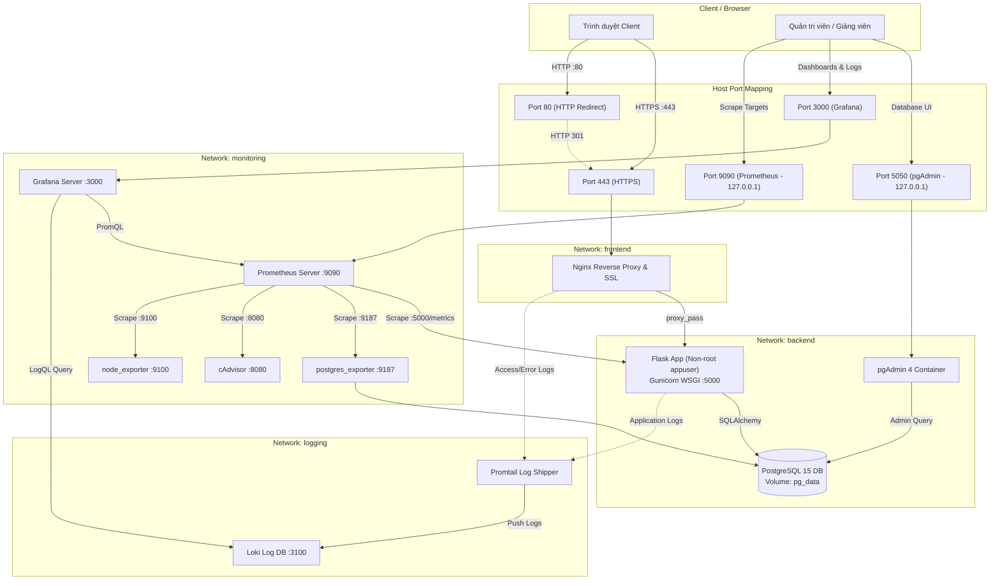

# HỆ THỐNG QUẢN LÝ THƯ VIỆN (LIBRARY MANAGEMENT SYSTEM)
### Đồ án môn học: Triển khai và Quản trị Hệ thống Phần mềm

[](https://docs.docker.com/compose/)
[](https://python.org/)
[](https://www.postgresql.org/)
[](https://nginx.org/)
[](https://prometheus.io/)
[](https://grafana.com/)
[](https://grafana.com/oss/loki/)
[](tests/)

---

## MỤC LỤC HƯỚNG DẪN

1. [Tên Đề Tài & Mô Tả Dự Án](#1-tên-đề-tài--mô-tả-dự-án)
2. [Mục Tiêu Dự Án](#2-mục-tiêu-dự-án)
3. [Công Nghệ Bắt Buộc Sử Dụng](#3-công-nghệ-bắt-buộc-sử-dụng)
4. [Kiến Trúc Hệ Thống](#4-kiến-trúc-hệ-thống)
5. [Sơ Đồ Kiến Trúc Hệ Thống (Mermaid Diagram)](#5-sơ-đồ-kiến-trúc-hệ-thống-mermaid-diagram)
6. [Cấu Trúc Thư Mục Dự Án](#6-cấu-trúc-thư-mục-dự-án)
7. [Yêu Cầu Môi Trường](#7-yêu-cầu-môi-trường)
8. [Hướng Dẫn Cài Đặt Docker Desktop & Docker Compose](#8-hướng-dẫn-cài-đặt-docker-desktop--docker-compose)
9. [Hướng Dẫn Clone Repository](#9-hướng-dẫn-clone-repository)
10. [Hướng Dẫn Tạo File `.env` Từ `.env.example`](#10-hướng-dẫn-tạo-file-env-từ-envexample)
11. [Hướng Dẫn Đặt Mật Khẩu An Toàn](#11-hướng-dẫn-đặt-mật-khẩu-an-toàn)
12. [Hướng Dẫn Sinh Chứng Chỉ SSL Tự Ký](#12-hướng-dẫn-sinh-chứng-chỉ-ssl-tự-ký)
13. [Hướng Dẫn Build & Khởi Động Hệ Thống](#13-hướng-dẫn-build--khởi-động-hệ-thống)
14. [Bảng Các Cổng Và URL Truy Cập](#14-bảng-các-cổng-và-url-truy-cập)
15. [Tài Khoản Demo Và Cách Tạo Mới](#15-tài-khoản-demo-và-cách-tạo-mới)
16. [Hướng Dẫn Kiểm Tra PostgreSQL Và pgAdmin 4](#16-hướng-dẫn-kiểm-tra-postgresql-và-pgadmin-4)
17. [Hướng Dẫn Sử Dụng Ứng Dụng Quản Lý Thư Viện](#17-hướng-dẫn-sử-dụng-ứng-dụng-quản-lý-thư-viện)
18. [Hướng Dẫn Kiểm Tra Prometheus Targets](#18-hướng-dẫn-kiểm-tra-prometheus-targets)
19. [Hướng Dẫn Sử Dụng Dashboard Grafana](#19-hướng-dẫn-sử-dụng-dashboard-grafana)
20. [Hướng Dẫn Sử Dụng Loki & LogQL](#20-hướng-dẫn-sử-dụng-loki--logql)
21. [Hướng Dẫn Kiểm Tra Hardening Bảo Mật](#21-hướng-dẫn-kiểm-tra-hardening-bảo-mật)
22. [Hướng Dẫn Chạy Bộ Kiểm Thử Tự Động (Tests)](#22-hướng-dẫn-chạy-bộ-kiểm-thử-tự-động-tests)
23. [Hướng Dẫn Xem Logs Và Xử Lý Sự Cố](#23-hướng-dẫn-xem-logs-và-xử-lý-sự-cố)
24. [Hướng Dẫn Sao Lưu Và Phục Hồi PostgreSQL (Backup & Restore)](#24-hướng-dẫn-sao-lưu-và-phục-hồi-postgresql-backup--restore)
25. [Hướng Dẫn Dừng Hệ Thống Và Lưu Ý Dữ Liệu Persistent](#25-hướng-dẫn-dừng-hệ-thống-và-lưu-ý-dữ-liệu-persistent)
26. [Danh Sách Screenshots Cần Chụp Để Đưa Vào Báo Cáo](#26-danh-sách-screenshots-cần-chụp-để-đưa-vào-báo-cáo)
27. [Trình Tự Demo Hoàn Hảo Trước Giảng Viên](#27-trình-tự-demo-hoàn-hảo-trước-giảng-viên)
28. [Hạn Chế Của Môi Trường Demo Local & Lưu Ý Khi Triển Khai Production](#28-hạn-chế-của-môi-trường-demo-local--lưu-ý-khi-triển-khai-production)

---

## 1. Tên Đề Tài & Mô Tả Dự Án
- **Tên đề tài**: HỆ THỐNG QUẢN LÝ THƯ VIỆN (Library Management System).
- **Mô tả**: Một giải pháp quản trị thư viện số toàn diện từ tầng ứng dụng web bằng Python Flask, lưu trữ quan hệ chuẩn ACID với PostgreSQL 15, quản trị qua pgAdmin 4, định tuyến bảo mật đa tầng qua Nginx Reverse Proxy (TLS 1.2/1.3), giám sát thời gian thực với Prometheus & Grafana, và quản lý log tập trung với Grafana Loki & Promtail. Toàn bộ 11 dịch vụ được container hóa và điều phối hoàn chỉnh bằng Docker Compose.

## 2. Mục Tiêu Dự Án
- Xây dựng ứng dụng quản lý sách, độc giả, quy trình mượn/trả sách có khóa dòng dữ liệu (`SELECT ... FOR UPDATE`) chống bán khống tồn kho.
- Đóng gói triển khai độc lập, có thể vận hành trên bất kỳ máy chủ nào chỉ với lệnh `docker compose up -d`.
- Thực hiện đầy đủ 3 commit chuẩn mực trên Git/GitHub.
- Giám sát độ trễ (latency p95), lưu lượng yêu cầu (req/s), tỷ lệ lỗi (4xx/5xx), chỉ số cơ sở dữ liệu và tài nguyên phần cứng.
- Thu thập và phân tích log truy vết sự cố thông qua LogQL.
- Áp dụng các kỹ thuật Hardening bảo mật chuẩn công nghiệp.

## 3. Công Nghệ Bắt Buộc Sử Dụng
- **Frontend**: HTML5, CSS3, Bootstrap 5.3, Bootstrap Icons, JavaScript.
- **Backend**: Python 3.10 (Flask, SQLAlchemy ORM, Gunicorn WSGI, Flask-WTF).
- **Database**: PostgreSQL 15 Alpine.
- **DB Tool**: pgAdmin 4.
- **Reverse Proxy**: Nginx 1.25 Alpine (TLS 1.2/1.3, HTTP/2, Security Headers).
- **Monitoring**: Prometheus v2.50.1 & Grafana v10.3.3.
- **Exporters**: `postgres_exporter`, `cAdvisor`, `node_exporter`, `prometheus_client`.
- **Logging**: Grafana Loki v2.9.4 & Promtail v2.9.4.
- **Version Control**: Git & GitHub (3 commits chính).

## 4. Kiến Trúc Hệ Thống
Hệ thống tuân thủ mô hình phòng thủ theo chiều sâu (Defense in Depth) với 4 phân vùng mạng Docker biệt lập:
- `frontend`: Tiếp nhận lưu lượng người dùng qua Nginx (cổng 80, 443).
- `backend`: Mạng nội bộ cho Flask, PostgreSQL, pgAdmin và postgres_exporter.
- `monitoring`: Mạng nội bộ cho Prometheus, Grafana và các Exporters.
- `logging`: Mạng nội bộ cho Promtail, Loki và Grafana Explore.

## 5. Sơ Đồ Kiến Trúc Hệ Thống (Mermaid Diagram)



## 6. Cấu Trúc Thư Mục Dự Án
```text
Quanlythuvien/
├── app/
│   ├── __init__.py           # Khởi tạo Flask App, ProxyFix, CSRF, Rotating File Logger
│   ├── extensions.py         # Khởi tạo db, csrf
│   ├── metrics.py            # Prometheus Metrics (Counter, Histogram, Gauges)
│   ├── models/               # SQLAlchemy Models: Book, Reader, Loan, LoanDetail
│   ├── routes/               # Blueprints: main, books, readers, loans
│   ├── services/             # LibraryService: Transaction, Row-level Locking
│   ├── static/               # CSS, JavaScript
│   └── templates/            # Giao diện Jinja2 Bootstrap 5 tiếng Việt
├── docker/
│   ├── nginx/                # File cấu hình nginx.conf và thư mục certs/
│   ├── prometheus/           # Cấu hình prometheus.yml
│   ├── grafana/              # Provisioning datasources, dashboards JSON
│   ├── loki/                 # Cấu hình loki-config.yml
│   └── promtail/             # Cấu hình promtail-config.yml
├── docs/
│   ├── architecture.md       # Tài liệu kiến trúc phân tầng
│   ├── deployment.md         # Hướng dẫn triển khai, vận hành, backup/restore
│   ├── security.md           # Báo cáo Hardening bảo mật chi tiết
│   ├── demo-checklist.md     # Kịch bản demo từng bước trước giảng viên
│   ├── report.md             # Báo cáo học phần hoàn chỉnh >= 10 trang
│   ├── report.docx           # File báo cáo định dạng Word chuẩn submission
│   └── screenshots/          # Hướng dẫn và checklist chụp 12 màn hình
├── scripts/
│   ├── seed.py               # Nạp dữ liệu mẫu an toàn (Idempotent)
│   ├── healthcheck.py        # Probe kiểm tra sức khỏe container
│   ├── generate_ssl.py       # Tự động sinh chứng chỉ TLS tự ký
│   └── generate_report_docx.py # Script sinh tài liệu báo cáo DOCX
├── tests/                    # 20 ca kiểm thử tự động với Pytest (100% Passed)
├── Dockerfile                # Hardened Non-Root Container Image
├── docker-compose.yml        # Điều phối 11 services và 4 isolated networks
├── requirements.txt          # Python dependencies
├── Makefile                  # Các lệnh thao tác nhanh
├── .env.example              # Mẫu biến môi trường an toàn
└── README.md                 # Tài liệu hướng dẫn chính của đề tài
```

## 7. Yêu Cầu Môi Trường
- **Hệ điều hành**: Windows 10/11 (khuyên dùng WSL2), Ubuntu 20.04+, macOS.
- **Docker Desktop** hoặc Docker Engine v24.0+ và Docker Compose v2.20+.
- **Git**.
- **RAM tối thiểu**: 8 GB (đáp ứng 11 containers chạy đồng thời).

## 8. Hướng Dẫn Cài Đặt Docker Desktop & Docker Compose
- **Windows**: Tải Docker Desktop từ [https://www.docker.com/products/docker-desktop/](https://www.docker.com/products/docker-desktop/). Khi cài đặt, tích chọn sử dụng **WSL 2 backend**.
  - Nếu gặp thông báo WSL chưa bật, mở PowerShell quyền Admin chạy: `wsl --install` và khởi động lại máy tính.
- **Linux (Ubuntu)**: Chạy lệnh:
  ```bash
  sudo apt update && sudo apt install -y docker.io docker-compose-v2
  sudo systemctl enable --now docker
  sudo usermod -aG docker $USER
  ```

## 9. Hướng Dẫn Clone Repository
```bash
git clone https://github.com/[TÊN_TAI_KHOAN]/[TEN_REPO].git
cd Quanlythuvien
```

## 10. Hướng Dẫn Tạo File `.env` Từ `.env.example`
```bash
# Trên Linux / macOS:
cp .env.example .env

# Trên Windows PowerShell:
Copy-Item .env.example .env

# Trên Windows CMD:
copy .env.example .env
```

## 11. Hướng Dẫn Đặt Mật Khẩu An Toàn
Mở file `.env` vừa tạo và cập nhật các mật khẩu bảo mật (tối thiểu 12 ký tự gồm chữ hoa, chữ thường, chữ số và ký tự đặc biệt):
```ini
POSTGRES_PASSWORD=MatKhauDatabaseBaoMat2025!
PGADMIN_DEFAULT_PASSWORD=MatKhauPgAdminBaoMat2025!
GRAFANA_ADMIN_PASSWORD=MatKhauGrafanaBaoMat2025!
SECRET_KEY=c3629b359f138e9a2638a1ef960d7031846b02a39281a1bb
```
> [!WARNING]
> Tuyệt đối không commit file `.env` lên GitHub. File `.env` đã được cấu hình trong `.gitignore`.

## 12. Hướng Dẫn Sinh Chứng Chỉ SSL Tự Ký
Chạy script tự động:
```bash
python scripts/generate_ssl.py
```
Script sẽ tạo ra cặp khóa `docker/nginx/certs/library.crt` và `docker/nginx/certs/library.key` có SAN cho `localhost`, `library.local`, `127.0.0.1`.

## 13. Hướng Dẫn Build & Khởi Động Hệ Thống
```bash
# Build và chạy ngầm toàn bộ 11 container
docker compose up -d --build

# Kiểm tra trạng thái sức khỏe
docker compose ps
```
Sau khoảng 10 giây, nạp dữ liệu mẫu khởi tạo:
```bash
docker compose exec web python scripts/seed.py
```

## 14. Bảng Các Cổng Và URL Truy Cập

| Dịch vụ | Địa chỉ URL Truy cập | Cổng Container | Phạm vi lắng nghe | Mô tả |
| :--- | :--- | :--- | :--- | :--- |
| **Website Thư Viện (HTTPS)** | `https://localhost` | `443` | `0.0.0.0` (Public) | Điểm truy cập chính của hệ thống |
| **Website Chuyển hướng (HTTP)** | `http://localhost` | `80` | `0.0.0.0` (Public) | Chuyển hướng 301 sang HTTPS |
| **Health API** | `https://localhost/health` | `443` (Nginx) | `0.0.0.0` (Public) | Kiểm tra sức khỏe App và Database |
| **Prometheus Metrics** | `https://localhost/metrics` | `443` (Nginx) | `0.0.0.0` (Public) | Chỉ số đo lường Flask |
| **pgAdmin 4** | `http://localhost:5050` | `80` | `127.0.0.1` (Local only) | Giao diện quản trị PostgreSQL |
| **Grafana Monitoring** | `http://localhost:3000` | `3000` | `0.0.0.0` | Dashboards giám sát và Log Explorer |
| **Prometheus Web UI** | `http://localhost:9090` | `9090` | `127.0.0.1` (Local only) | Bảng điều khiển cào chỉ số |
| **PostgreSQL Database** | `localhost:5432` | `5432` | `127.0.0.1` (Local only) | Cổng dữ liệu nội bộ |
| **Loki Log Server** | `loki:3100` | `3100` | `logging` (Internal) | Lưu trữ log tập trung |

## 15. Tài Khoản Demo Và Cách Tạo Mới / Khôi Phục Mật Khẩu
- **pgAdmin 4**:
  - Email: `admin@library.local` (hoặc giá trị trong file `.env`)
  - Password: `ChangePgAdminPassword123!` (hoặc giá trị trong file `.env`)
- **Grafana**:
  - Username: `admin`
  - Password: `ChangeGrafanaAdmin123!` (lưu ý có dấu chấm than `!` ở cuối theo quy tắc mật khẩu mạnh trong `.env`)
  - *Lưu ý kỹ thuật quan trọng*: Biến môi trường `GF_SECURITY_ADMIN_PASSWORD` chỉ có hiệu lực ở **lần khởi động đầu tiên** khi cơ sở dữ liệu Grafana (`grafana.db` trong volume `grafana_data`) được tạo mới. Nếu bạn đã chạy hệ thống từ trước và muốn đổi hoặc khôi phục mật khẩu tài khoản admin, hãy sử dụng lệnh CLI chính thức của Grafana:
    ```bash
    # Đặt lại mật khẩu admin an toàn (không làm mất dashboards hay datasources):
    docker compose exec grafana grafana cli admin reset-admin-password '<MAT_KHAU_MOI>'
    ```
- **PostgreSQL**:
  - Host: `db`, Port: `5432`, DB: `library_db`, User: `library_user`, Password: giá trị trong `.env`.

## 16. Hướng Dẫn Kiểm Tra PostgreSQL Và pgAdmin 4
1. Mở `http://localhost:5050`, đăng nhập bằng tài khoản pgAdmin.
2. Bấm chuột phải vào `Servers` -> `Register` -> `Server...`.
3. Đặt tên: `Library DB`. Tab **Connection**: Host = `db`, Port = `5432`, Database = `library_db`, Username = `library_user`, Password = giá trị trong `.env`.
4. Xem cấu trúc 4 bảng: `books`, `readers`, `loans`, `loan_details`.

## 17. Hướng Dẫn Sử Dụng Ứng Dụng Quản Lý Thư Viện
- **Xem Dashboard**: Mở `https://localhost`, theo dõi 4 thẻ thống kê tổng quan và lịch sử mượn gần đây.
- **Thêm/Sửa/Tìm Sách**: Vào tab "Quản lý Sách", tìm kiếm từ khóa, phân trang, thêm sách mới hoặc cập nhật thông tin.
- **Quản lý Độc Giả**: Vào tab "Quản lý Độc giả", xem danh sách và cấp thẻ mới. Độc giả đã mượn sách sẽ được hệ thống bảo toàn dữ liệu bằng cách đổi trạng thái sang "Ngừng hoạt động" khi xóa.
- **Mượn Sách**: Vào "Mượn & Trả sách" -> "Tạo Phiếu Mượn", chọn độc giả, tích chọn các cuốn sách và số lượng. Hệ thống sẽ khóa dòng và trừ tồn kho tự động.
- **Trả Sách**: Mở chi tiết phiếu mượn, bấm "Trả sách này" hoặc "Trả Toàn Bộ Sách". Thử bấm trả lần hai để thấy cơ chế ngăn chặn trả trùng lặp.

## 18. Hướng Dẫn Kiểm Tra Prometheus Targets
1. Truy cập: `http://localhost:9090/targets`.
2. Quan sát thấy 5 scrape jobs đều có trạng thái **State: UP (1/1)** màu xanh:
   - `library-app` (`web:5000/metrics`)
   - `postgres-exporter` (`postgres-exporter:9187/metrics`)
   - `cadvisor` (`cadvisor:8080/metrics`)
   - `node-exporter` (`node-exporter:9100/metrics`)
   - `prometheus` (`localhost:9090`)

## 19. Hướng Dẫn Sử Dụng Dashboard Grafana
1. Truy cập: `http://localhost:3000`, đăng nhập tài khoản Grafana.
2. Vào **Dashboards** -> Chọn thư mục **Library Infrastructure**:
   - **Hệ Thống - Giám Sát Tài Nguyên & Containers**: Xem CPU, RAM, Network I/O của từng container.
   - **Cơ Sở Dữ Liệu - PostgreSQL Metrics**: Xem trạng thái DB, số kết nối mở, tỷ lệ Commit/Rollback, Cache Hit Ratio.
   - **Ứng Dụng - Flask Metrics & Hiệu Năng**: Xem thông lượng xử lý req/s, tỷ lệ lỗi HTTP, thời gian đáp ứng (Latency p95, p50), số phiếu mượn active thời gian thực.

## 20. Hướng Dẫn Sử Dụng Loki & LogQL
1. Trong Grafana, mở menu **Explore** (biểu tượng la bàn).
2. Chọn Datasource là **Loki**.
3. Chạy 3 câu truy vấn LogQL tiêu chuẩn:
   - **Query 1 — Xem log ứng dụng Flask**:
     ```logql
     {job="library-app"}
     ```
   - **Query 2 — Xem log truy cập Nginx Reverse Proxy**:
     ```logql
     {job="nginx"}
     ```
   - **Query 3 — Lọc nhanh các bản ghi lỗi ERROR**:
     ```logql
     {job="library-app"} |= "ERROR"
     ```

## 21. Hướng Dẫn Kiểm Tra Hardening Bảo Mật
- **Kiểm tra Non-root User**:
  ```bash
  docker compose exec web whoami
  # Kết quả: appuser (UID: 10001)
  ```
- **Kiểm tra Security Headers qua cURL**:
  ```bash
  curl -kI https://localhost
  # Hiển thị X-Content-Type-Options: nosniff, X-Frame-Options: SAMEORIGIN, Content-Security-Policy...
  ```
- **Kiểm tra chuyển hướng HTTP 301**:
  ```bash
  curl -I http://localhost
  # Trả về HTTP/1.1 301 Moved Permanently -> Location: https://localhost/
  ```
- **Kiểm tra Resource Limits**:
  ```bash
  docker stats --no-stream
  # Xem ngưỡng giới hạn RAM (MEM LIMIT) cho từng container
  ```

## 22. Hướng Dẫn Chạy Bộ Kiểm Thử Tự Động (Tests)
Dự án tích hợp bộ 20 bài test tự động bao phủ trọn vẹn nghiệp vụ và API:
```bash
python -m pytest tests/ -v
```
Kết quả đạt được: **20 passed in 0.82s (100% tỷ lệ thành công)**.

## 23. Hướng Dẫn Xem Logs Và Xử Lý Sự Cố
```bash
# Xem log toàn bộ hệ thống
docker compose logs -f

# Xem log riêng một dịch vụ
docker compose logs -f web
docker compose logs -f nginx
docker compose logs -f db

# Xử lý khi cổng bị xung đột:
# Mở file .env đổi HTTP_PORT=8080 và HTTPS_PORT=8443, sau đó chạy docker compose up -d
```

## 24. Hướng Dẫn Sao Lưu Và Phục Hồi PostgreSQL (Backup & Restore)
- **Sao lưu**:
  ```bash
  docker compose exec -T db pg_dump -U library_user library_db > backup_library.sql
  ```
- **Phục hồi**:
  ```bash
  docker compose exec -T db psql -U library_user -d library_db < backup_library.sql
  ```

## 25. Hướng Dẫn Dừng Hệ Thống Và Lưu Ý Dữ Liệu Persistent
```bash
# Dừng hệ thống an toàn (Dữ liệu database trong volume pg_data được bảo toàn):
docker compose down

# CẢNH BÁO: Chỉ sử dụng lệnh sau khi muốn xóa sạch toàn bộ dữ liệu để cài lại từ đầu:
docker compose down -v
```

## 26. Danh Sách Screenshots Cần Chụp Để Đưa Vào Báo Cáo
Xem chi tiết hướng dẫn và danh sách 12 ảnh cần chụp tại: [docs/screenshots/README.md](file:///d:/Quanlythuvien/docs/screenshots/README.md).

## 27. Trình Tự Demo Hoàn Hảo Trước Giảng Viên
Xem kịch bản chi tiết 8 bước trình bày tự tin và chuyên nghiệp tại: [docs/demo-checklist.md](file:///d:/Quanlythuvien/docs/demo-checklist.md).

## 28. Hạn Chế Của Môi Trường Demo Local & Lưu Ý Khi Triển Khai Production
1. **Chứng chỉ SSL**: Bản local dùng chứng chỉ tự ký (`Self-signed`). Khi triển khai Production công khai, cần cấu hình Certbot container để cấp chứng chỉ tự động miễn phí từ **Let's Encrypt**.
2. **Quản lý Secrets**: Production nên chuyển từ file `.env` sang hệ thống quản lý tập trung như **HashiCorp Vault** hoặc Kubernetes Secrets.
3. **Cơ sở dữ liệu**: Production cần thiết lập cơ chế High Availability (PostgreSQL Streaming Replication) kết hợp PgBouncer làm Connection Pooler.
