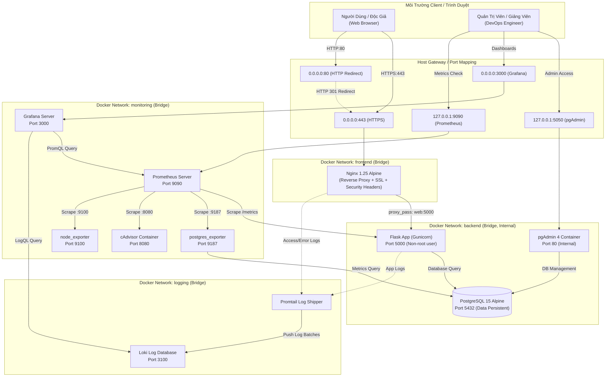
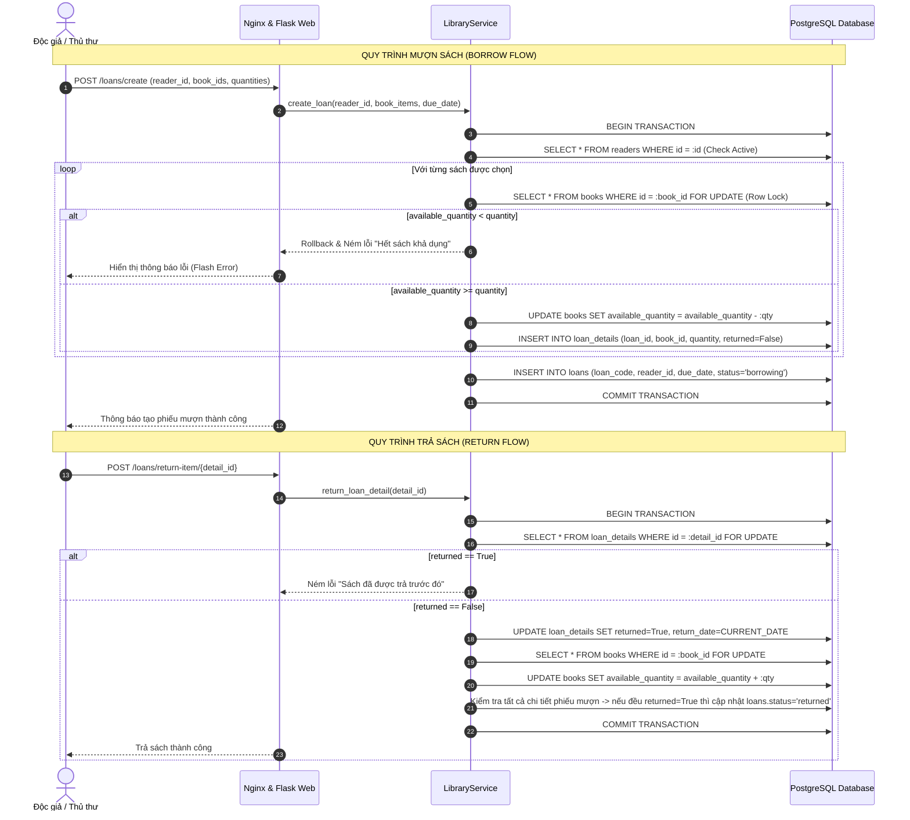

# TÀI LIỆU KIẾN TRÚC HỆ THỐNG QUẢN LÝ THƯ VIỆN
### Triển khai và Quản trị Hệ thống Phần mềm

---

## 1. Tổng Quan Kiến Trúc (Architecture Overview)

Hệ thống Quản lý Thư viện được xây dựng theo kiến trúc phân tầng dạng vi dịch vụ (Microservices-ready containerized architecture) được điều phối thông qua **Docker Compose**. Mô hình phân tách rõ ràng giữa 4 phân hệ:

1. **Phân hệ Proxy & Trình diễn (Edge & Presentation Layer)**: Nginx Reverse Proxy tiếp nhận lưu lượng HTTP/HTTPS, chấm dứt SSL (TLS Termination), áp dụng các chính sách bảo mật Security Headers và chuyển tiếp an toàn vào Flask App.
2. **Phân hệ Ứng dụng & Dữ liệu (Application & Persistence Layer)**: Flask WSGI Application kết nối với PostgreSQL 15, hỗ trợ công cụ quản trị web pgAdmin 4.
3. **Phân hệ Giám sát (Monitoring Layer)**: Prometheus thực hiện cào (scrape) chỉ số định kỳ từ Flask `/metrics`, `postgres_exporter`, `cAdvisor` và `node_exporter`. Grafana trực quan hóa dữ liệu qua các dashboard tự động nạp.
4. **Phân hệ Thu thập Log Tập Trung (Centralized Logging Layer)**: Promtail thu thập log file từ container và Nginx, đẩy dữ liệu về Loki, cho phép truy vấn LogQL thời gian thực.

---

## 2. Sơ Đồ Kiến Trúc Chi Tiết (Mermaid Diagram)

---

## 3. Thiết Kế Mạng Docker & Nguyên Tắc Đặc Quyền Tối Thiểu

Dự án phân bổ 4 Docker Network riêng biệt:

| Tên Network | Driver | Các Container Tham Gia | Mục Đích & Ràng Buộc Bảo Mật |
| :--- | :--- | :--- | :--- |
| `frontend` | bridge | `nginx`, `web` | Tiếp nhận và xử lý lưu lượng HTTP/S người dùng. Chỉ Nginx mở port ra ngoài. |
| `backend` | bridge | `web`, `db`, `pgadmin`, `postgres-exporter` | Lưu lượng truy vấn dữ liệu nhạy cảm. Không thể truy cập trực tiếp từ Internet. |
| `monitoring` | bridge | `prometheus`, `grafana`, `postgres-exporter`, `cadvisor`, `node-exporter`, `web` | Thu thập chỉ số định kỳ, cách ly luồng dữ liệu giám sát với luồng nghiệp vụ. |
| `logging` | bridge | `promtail`, `loki`, `grafana` | Vận chuyển log từ các dịch vụ về kho lưu trữ tập trung. |

---

## 4. Danh Sách Dịch Vụ Và Phân Bổ Tài Nguyên (Resource Limits)

| Tên Dịch Vụ | Docker Image | CPU Limit | Memory Limit | Restart Policy | Volume Gắn Kết |
| :--- | :--- | :--- | :--- | :--- | :--- |
| `web` | Custom (Dockerfile) | 1.0 CPU | 512 MB | unless-stopped | `instance`, `logs` |
| `db` | `postgres:15-alpine` | 1.0 CPU | 512 MB | unless-stopped | `pg_data` |
| `pgadmin` | `dpage/pgadmin4:8.14` | 0.5 CPU | 384 MB | unless-stopped | `pgadmin_data` |
| `nginx` | `nginx:1.25-alpine` | 0.5 CPU | 256 MB | unless-stopped | `nginx.conf`, `certs`, `nginx_logs` |
| `prometheus`| `prom/prometheus:v2.50.1`| 0.5 CPU | 512 MB | unless-stopped | `prometheus.yml`, `prom_data` |
| `grafana` | `grafana/grafana:10.3.3` | 0.5 CPU | 512 MB | unless-stopped | `provisioning`, `dashboards`, `grafana_data` |
| `postgres-exporter`| `prometheuscommunity/postgres-exporter:v0.15.0` | 0.2 CPU | 128 MB | unless-stopped | - |
| `cadvisor` | `gcr.io/cadvisor/cadvisor:v0.49.1` | 0.5 CPU | 256 MB | unless-stopped | `/sys`, `/var/lib/docker` (ro) |
| `node-exporter`| `prom/node-exporter:v1.7.0` | 0.2 CPU | 128 MB | unless-stopped | `/proc`, `/sys` (ro) |
| `loki` | `grafana/loki:2.9.4` | 0.5 CPU | 512 MB | unless-stopped | `loki-config.yml`, `loki_data` |
| `promtail` | `grafana/promtail:2.9.4`| 0.2 CPU | 256 MB | unless-stopped | `promtail-config.yml`, `nginx_logs` |

---

## 5. Quy Trình Mượn Và Trả Sách (Transaction & Row Locking)

