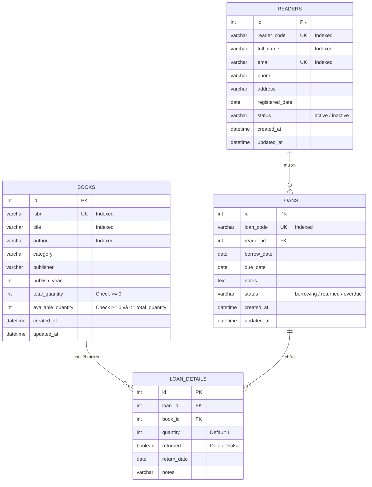
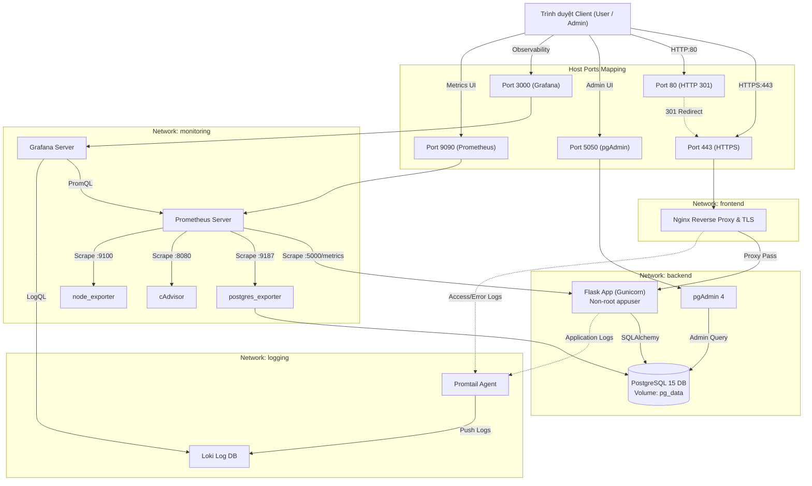

# BÁO CÁO ĐỒ ÁN HỌC PHẦN
## HỌC PHẦN: TRIỂN KHAI VÀ QUẢN TRỊ HỆ THỐNG PHẦN MỀM

---

### THÔNG TIN BÌA BÁO CÁO

- **TRƯỜNG**: [ĐIỀN TÊN TRƯỜNG - VÍ DỤ: ĐẠI HỌC CÔNG NGHỆ THÔNG TIN VÀ TRUYỀN THÔNG]
- **KHOA / BỘ MÔN**: [ĐIỀN KHOA/BỘ MÔN - VÍ DỤ: KHOA CÔNG NGHỆ THÔNG TIN]
- **HỌC PHẦN**: Triển khai và Quản trị Hệ thống Phần mềm
- **ĐỀ TÀI**: **HỆ THỐNG QUẢN LÝ THƯ VIỆN (LIBRARY MANAGEMENT SYSTEM)**
- **SINH VIÊN THỰC HIỆN**: [HỌ VÀ TÊN SINH VIÊN]
- **MÃ SỐ SINH VIÊN**: [MÃ SỐ SINH VIÊN - VÍ DỤ: DTC245200156]
- **LỚP**: [LỚP SINH VIÊN]
- **GIẢNG VIÊN HƯỚNG DẪN**: [TÊN GIẢNG VIÊN HƯỚNG DẪN]
- **ĐỊA ĐIỂM VÀ NĂM THỰC HIỆN**: [ĐỊA ĐIỂM, NĂM 2025/2026]

---

## MỤC LỤC

- [Chương 1. Giới Thiệu Đề Tài](#chương-1-giới-thiệu-đề-tài)
  - [1.1. Lý do chọn đề tài](#11-lý-do-chọn-đề-tài)
  - [1.2. Mục tiêu nghiên cứu và triển khai](#12-mục-tiêu-nghiên-cứu-và-triển-khai)
  - [1.3. Phạm vi đề tài](#13-phạm-vi-đề-tài)
  - [1.4. Công nghệ bắt buộc sử dụng](#14-công-nghệ-bắt-buộc-sử-dụng)
- [Chương 2. Phân Tích Và Thiết Kế Hệ Thống](#chương-2-phân-tích-và-thiết-kế-hệ-thống)
  - [2.1. Yêu cầu chức năng](#21-yêu-cầu-chức-năng)
  - [2.2. Yêu cầu phi chức năng](#22-yêu-cầu-phi-chức-năng)
  - [2.3. Đối tượng sử dụng hệ thống](#23-đối-tượng-sử-dụng-hệ-thống)
  - [2.4. Thiết kế cơ sở dữ liệu và quan hệ giữa các bảng](#24-thiết-kế-cơ-sở-dữ-liệu-và-quan-hệ-giữa-các-bảng)
  - [2.5. Sơ đồ kiến trúc tổng thể](#25-sơ-đồ-kiến-trúc-tổng-thể)
  - [2.6. Luồng xử lý mượn và trả sách](#26-luồng-xử-lý-mượn-và-trả-sách)
- [Chương 3. Xây Dựng Ứng Dụng Và Cơ Sở Dữ Liệu](#chương-3-xây-dựng-ứng-dụng-và-cơ-sở-dữ-liệu)
  - [3.1. Cấu trúc mã nguồn dự án](#31-cấu-trúc-mã-nguồn-dự-án)
  - [3.2. Thiết kế các module nghiệp vụ](#32-thiết-kế-các-module-nghiệp-vụ)
  - [3.3. Mô hình dữ liệu ORM](#33-mô-hình-dữ-liệu-orm)
  - [3.4. Đóng gói Dockerfile và Docker Compose](#34-đóng-gói-dockerfile-và-docker-compose)
  - [3.5. Kết nối Flask với PostgreSQL và pgAdmin](#35-kết-nối-flask-với-postgresql-và-pgadmin)
  - [3.6. Kết quả kiểm thử nghiệp vụ](#36-kết-quả-kiểm-thử-nghiệp-vụ)
- [Chương 4. Cấu Hình Nginx Reverse Proxy Và Bảo Mật HTTPS](#chương-4-cấu-hình-nginx-reverse-proxy-và-bảo-mật-https)
  - [4.1. Nguyên lý hoạt động của Reverse Proxy](#41-nguyên-lý-hoạt-động-của-reverse-proxy)
  - [4.2. Sơ đồ luồng truy cập và chuyển hướng HTTPS](#42-sơ-đồ-luồng-truy-cập-và-chuyển-hướng-https)
  - [4.3. Cấu hình Nginx và chứng chỉ TLS tự ký](#43-cấu-hình-nginx-và-chứng-chỉ-tls-tự-ký)
  - [4.4. Cấu hình Security Headers](#44-cấu-hình-security-headers)
  - [4.5. Kết quả kiểm tra Reverse Proxy](#45-kết-quả-kiểm-tra-reverse-proxy)
- [Chương 5. Triển Khai Hệ Thống Giám Sát Prometheus Và Grafana](#chương-5-triển-khai-hệ-thống-giám-sát-prometheus-và-grafana)
  - [5.1. Kiến trúc phân hệ Monitoring](#51-kiến-trúc-phân-hệ-monitoring)
  - [5.2. Cấu hình Scrape Jobs của Prometheus](#52-cấu-hình-scrape-jobs-của-prometheus)
  - [5.3. Các bộ xuất chỉ số (Exporters)](#53-các-bộ-xuất-chỉ-số-exporters)
  - [5.4. Thiết kế và nạp tự động Dashboards trên Grafana](#54-thiết-kế-và-nạp-tự-động-dashboards-trên-grafana)
  - [5.5. Các câu truy vấn PromQL minh họa](#55-các-câu-truy-vấn-promql-minh-họa)
  - [5.6. Kết quả thu thập chỉ số](#56-kết-quả-thu-thập-chỉ-số)
- [Chương 6. Triển Khai Hệ Thống Log Tập Trung Loki Và Promtail](#chương-6-triển-khai-hệ-thống-log-tập-trung-loki-và-promtail)
  - [6.1. Kiến trúc phân hệ Logging](#61-kiến-trúc-phân-hệ-logging)
  - [6.2. Luồng thu thập log từ Nginx và Flask](#62-luồng-thu-thập-log-từ-nginx-và-flask)
  - [6.3. Cấu hình nhãn (Labels) và chính sách lưu trữ](#63-cấu-hình-nhãn-labels-và-chính-sách-lưu-trữ)
  - [6.4. Các câu truy vấn LogQL thực tế](#64-các-câu-truy-vấn-logql-thực-tế)
  - [6.5. Kết quả truy vấn log trên Grafana Explore](#65-kết-quả-truy-vấn-log-trên-grafana-explore)
- [Chương 7. Hardening Bảo Mật Hệ Thống](#chương-7-hardening-bảo-mật-hệ-thống)
  - [7.1. Phân tích các mối nguy cơ an toàn thông tin](#71-phân-tích-các-mối-nguy-cơ-an-toàn-thông-tin)
  - [7.2. Triển khai Non-Root Container](#72-triển-khai-non-root-container)
  - [7.3. Phân tách mạng Docker (Network Isolation)](#73-phân-tách-mạng-docker-network-isolation)
  - [7.4. Quản lý bí mật qua biến môi trường (.env)](#74-quản-lý-bí-mật-qua-biến-môi-trường-env)
  - [7.5. Cô lập cổng cơ sở dữ liệu và quản trị](#75-cô-lập-cổng-cơ-sở-dữ-liệu-và-quản-trị)
  - [7.6. Giới hạn tài nguyên và chống leo thang đặc quyền](#76-giới-hạn-tài-nguyên-và-chống-leo-thang-đặc-quyền)
  - [7.7. Bảng kiểm tra tổng hợp các biện pháp bảo mật](#77-bảng-kiểm-tra-tổng-hợp-các-biện-pháp-bảo-mật)
- [Chương 8. Triển Khai, Kiểm Thử Và Đánh Giá](#chương-8-triển-khai-kiểm-thử-và-đánh-giá)
  - [8.1. Các bước triển khai thực tế trên môi trường](#81-các-bước-triển-khai-thực-tế-trên-môi-trường)
  - [8.2. Kết quả kiểm thử tự động với Pytest](#82-kết-quả-kiểm-thử-tự-động-với-pytest)
  - [8.3. Sự cố gặp phải và biện pháp khắc phục](#83-sự-cố-gặp-phải-và-biện-pháp-khắc-phục)
  - [8.4. Đánh giá kết quả đạt được](#84-đánh-giá-kết-quả-đạt-được)
  - [8.5. Giới hạn và hướng phát triển](#85-giới-hạn-và-hướng-phát-triển)
- [Kết Luận](#kết-luận)
- [Tài Liệu Tham Khảo](#tài-liệu-tham-khảo)
- [Phụ Lục](#phụ-lục)

---

## CHƯƠNG 1. GIỚI THIỆU ĐỀ TÀI

### 1.1. Lý do chọn đề tài
Trong kỷ nguyên chuyển đổi số và công nghiệp phần mềm hiện đại, việc xây dựng một ứng dụng không chỉ dừng lại ở khâu lập trình tính năng (Coding), mà khâu triển khai (Deployment), vận hành (Operations), giám sát (Monitoring) và bảo mật (Security Hardening) đóng vai trò quyết định đến tính ổn định và sự thành bại của hệ thống. 

Đề tài **"Hệ Thống Quản Lý Thư Viện"** được lựa chọn vì tính thực tiễn cao, bao hàm đầy đủ các bài toán cốt lõi của một hệ thống quản lý thông tin:
- Quản lý kho tài nguyên hữu hạn (sách, tài liệu số) đòi hỏi tính nhất quán cao về dữ liệu (Data Consistency), chống mượn vượt số lượng khả dụng trong môi trường có nhiều người dùng đồng thời.
- Quản lý quy trình vòng đời mượn - trả, tính toán hạn nộp, đôn đốc thu hồi tài liệu quá hạn.
- Đòi hỏi kiến trúc hạ tầng vững chắc, có khả năng tự động hóa triển khai bằng Docker Compose, bảo vệ đa tầng bằng Nginx Reverse Proxy, theo dõi sức khỏe liên tục bằng Prometheus và phân tích log sự cố bằng Loki.

### 1.2. Mục tiêu nghiên cứu và triển khai
1. **Mục tiêu ứng dụng**: Xây dựng một ứng dụng web hoàn chỉnh, giao diện tiếng Việt thân thiện, đáp ứng các nghiệp vụ quản lý thư viện chuẩn mực (Dashboard thống kê, danh mục sách, quản lý độc giả, lập phiếu mượn/trả, cập nhật tồn kho an toàn trong transaction).
2. **Mục tiêu DevOps & Triển khai**: Container hóa toàn bộ các dịch vụ bằng Docker và Docker Compose, tách biệt môi trường, bảo đảm có thể chạy trơn tru chỉ với một lệnh `docker compose up -d`.
3. **Mục tiêu Giám sát & Quản trị**: Xây dựng hệ thống giám sát định lượng với Prometheus và Grafana, thu thập metrics từ tầng ứng dụng, cơ sở dữ liệu, container và máy chủ vật lý; thiết lập kho lưu trữ log tập trung với Grafana Loki và Promtail.
4. **Mục tiêu Bảo mật**: Áp dụng các quy tắc bảo mật khắt khe như chạy tiến trình non-root, phân tách mạng (Network Segmentation), bảo vệ CSRF, chống SQL Injection, áp dụng Security Headers và cấu hình TLS trên Nginx.

### 1.3. Phạm vi đề tài
- **Phạm vi nghiệp vụ**: Quản lý sách, độc giả, phiếu mượn trả, thống kê tổng quan thư viện số.
- **Phạm vi môi trường**: Đóng gói hoàn chỉnh trên môi trường Docker Compose cục bộ (Local Server), chuẩn bị sẵn sàng cho việc đóng gói chuyển giao lên cụm máy chủ sản xuất hoặc hạ tầng đám mây (Cloud / Kubernetes).

### 1.4. Công nghệ bắt buộc sử dụng
Hệ thống tuân thủ nghiêm ngặt các công nghệ chuẩn được yêu cầu trong đề cương học phần:
- **Frontend**: HTML5, CSS3, Bootstrap 5.3, Bootstrap Icons, JavaScript.
- **Backend**: Python 3.10 (Flask Framework, SQLAlchemy ORM, Gunicorn WSGI, Flask-WTF).
- **Cơ sở dữ liệu**: PostgreSQL 15 Alpine.
- **Công cụ quản trị DB**: pgAdmin 4.
- **Reverse Proxy & SSL**: Nginx 1.25 Alpine, cấu hình TLS và Security Headers.
- **Monitoring**: Prometheus v2.50.1, Grafana v10.3.3, postgres_exporter, cAdvisor, node_exporter.
- **Logging**: Grafana Loki v2.9.4 và Promtail v2.9.4.
- **Quản lý mã nguồn**: Git & GitHub với đúng 3 commit chính theo tiến độ.

---

## CHƯƠNG 2. PHÂN TÍCH VÀ THIẾT KẾ HỆ THỐNG

### 2.1. Yêu cầu chức năng
Hệ thống đáp ứng các nhóm chức năng chính:
1. **Bảng điều khiển (Dashboard)**:
   - Tổng hợp số lượng tựa sách, tổng số bản in, số lượng sách còn khả dụng trong kho.
   - Số lượng độc giả đã đăng ký và độc giả đang hoạt động.
   - Số lượng phiếu mượn đang lưu hành và số phiếu mượn đang bị quá hạn trả.
   - Danh sách các hoạt động mượn trả và sách mới cập nhật gần đây nhất.
   - Toàn bộ số liệu được tổng hợp động trực tiếp từ PostgreSQL thông qua các câu truy vấn aggregate.
2. **Quản lý danh mục sách (Books Management)**:
   - Thêm mới, chỉnh sửa, xem chi tiết và xóa sách.
   - Kiểm tra ràng buộc tồn tại: Không cho phép xóa sách khi đang có người mượn hoặc đã có lịch sử mượn trả (để bảo vệ toàn vẹn lịch sử).
   - Ràng buộc số lượng: Số lượng sách khả dụng (`available_quantity`) không bao giờ được âm và không được lớn hơn tổng số sách (`total_quantity`).
   - Tìm kiếm sách đa tiêu chí: Theo tên sách, tác giả hoặc mã số tiêu chuẩn ISBN; lọc theo thể loại; phân trang tự động.
3. **Quản lý độc giả (Readers Management)**:
   - Cấp thẻ mới: Lưu trữ mã thẻ độc giả, họ tên, email duy nhất, số điện thoại, địa chỉ và ngày cấp thẻ.
   - Cập nhật thông tin độc giả và trạng thái thẻ (`active` hoặc `inactive`).
   - Xóa an toàn (Soft Deactivation): Khi độc giả đã có lịch sử mượn trả, hệ thống tự động chuyển trạng thái thẻ sang "Ngừng hoạt động" để bảo tồn lịch sử giao dịch thay vì xóa cứng.
4. **Quản lý mượn và trả sách (Loans & Returns)**:
   - Lập phiếu mượn: Chọn một độc giả đang hoạt động và một hoặc nhiều đầu sách với số lượng tương ứng.
   - Kiểm tra tồn kho trước khi cho mượn: Nếu bất kỳ sách nào không đủ số lượng tồn trong kho, giao dịch lập tức bị hủy bỏ (Rollback) và thông báo cụ thể cho thủ thư.
   - Xử lý trả sách: Hỗ trợ trả từng cuốn sách riêng lẻ hoặc trả toàn bộ sách trong phiếu mượn.
   - Chống trả trùng lặp: Ngăn chặn tuyệt đối việc hoàn trả một cuốn sách đã được ghi nhận trả trước đó.
   - Tự động đánh dấu quá hạn (`overdue`) khi ngày hiện tại vượt quá hạn trả sách (`due_date`).

### 2.2. Yêu cầu phi chức năng
- **Tính toàn vẹn và nhất quán dữ liệu (ACID Compliance)**: Đảm bảo không xảy ra hiện tượng "bán khống" (overdraft) sách khi có nhiều yêu cầu mượn đồng thời. Sử dụng cơ chế khóa dòng `SELECT ... FOR UPDATE` trong transaction của PostgreSQL.
- **Tính sẵn sàng và tự phục hồi (High Availability & Self-healing)**: Các dịch vụ có chính sách khởi động lại `restart: unless-stopped`, có cấu hình Docker Healthcheck để giám sát tình trạng sống/chết.
- **Hiệu năng (Performance)**: Phản hồi các yêu cầu trang web dưới 200ms; Nginx thực hiện nén Gzip các tài nguyên tĩnh; kết nối DB thông qua Connection Pool.
- **Bảo mật (Security)**: Phân tách mạng, bảo vệ CSRF, chống SQL Injection, mã hóa kênh truyền HTTPS, ẩn dấu vết hệ thống khi gặp lỗi.

### 2.3. Đối tượng sử dụng hệ thống
1. **Thủ thư / Cán bộ quản lý thư viện**: Sử dụng giao diện web để tìm kiếm, quản lý sách, độc giả và xử lý phiếu mượn trả hàng ngày.
2. **Quản trị viên hệ thống (DevOps / SysAdmin)**: Theo dõi sức khỏe máy chủ qua Grafana, kiểm tra lỗi qua Loki, quản lý cơ sở dữ liệu qua pgAdmin 4.
3. **Độc giả / Sinh viên**: Tra cứu tình trạng đầu sách trên website thư viện.

### 2.4. Thiết kế cơ sở dữ liệu và quan hệ giữa các bảng

Cơ sở dữ liệu gồm 4 bảng quan hệ được thiết kế chuẩn hóa bậc 3 (3NF):



- **Ràng buộc toàn vẹn tại tầng DB**:
  - `check_total_quantity_non_negative`: `total_quantity >= 0`
  - `check_available_quantity_non_negative`: `available_quantity >= 0`
  - `check_available_le_total`: `available_quantity <= total_quantity`
  - Khóa ngoại từ `loan_details.book_id` liên kết tới `books.id` với hành vi `RESTRICT` ngăn xóa sách đang có liên kết.
  - Khóa ngoại từ `loans.reader_id` liên kết tới `readers.id` với hành vi `RESTRICT`.

### 2.5. Sơ đồ kiến trúc tổng thể



### 2.6. Luồng xử lý mượn và trả sách
- **Luồng mượn sách**:
  1. Thủ thư gửi yêu cầu tạo phiếu mượn kèm mã độc giả, ngày hẹn trả và danh sách các cuốn sách.
  2. Bắt đầu giao dịch Database (`db.session.begin()`).
  3. Khóa các dòng dữ liệu sách tương ứng trong bảng `books` bằng `SELECT ... FOR UPDATE` để tránh Race Condition khi có 2 yêu cầu cùng đến trong một mili giây.
  4. Kiểm tra tồn kho khả dụng: Nếu `available_quantity < quantity`, lập tức ném ngoại lệ và Rollback.
  5. Cập nhật trừ số lượng `available_quantity -= quantity`.
  6. Tạo bản ghi `loans` và các bản ghi con `loan_details`.
  7. Commit transaction hoàn tất.
- **Luồng trả sách**:
  1. Khóa bản ghi `loan_details` cần trả bằng `SELECT ... FOR UPDATE`.
  2. Kiểm tra nếu trường `returned` đã là `True`, lập tức từ chối thao tác (ngăn trả 2 lần).
  3. Cập nhật `returned = True`, lưu ngày trả `return_date = CURRENT_DATE`.
  4. Khóa dòng sách và cộng lại số lượng vào kho: `available_quantity += quantity`.
  5. Kiểm tra nếu tất cả sách trong phiếu mượn đã được hoàn trả, tự động đổi trạng thái phiếu sang `returned`.
  6. Commit transaction.

---

## CHƯƠNG 3. XÂY DỰNG ỨNG DỤNG VÀ CƠ SỞ DỮ LIỆU

### 3.1. Cấu trúc mã nguồn dự án
Dự án được tổ chức theo chuẩn kiến trúc mô hình Module Factory của Flask:

```text
d:/Quanlythuvien/
├── app/
│   ├── __init__.py           # Khởi tạo App Factory, ProxyFix, CSRF, Error Handlers
│   ├── extensions.py         # Khởi tạo SQLAlchemy và CSRFProtect
│   ├── metrics.py            # Khởi tạo Prometheus Counter, Histogram, Gauge
│   ├── models/
│   │   ├── __init__.py
│   │   ├── book.py           # Model Book và Check Constraints
│   │   ├── reader.py         # Model Reader
│   │   └── loan.py           # Model Loan và LoanDetail
│   ├── routes/
│   │   ├── __init__.py       # Đăng ký các Blueprints
│   │   ├── main.py           # Route Dashboard và /health
│   │   ├── books.py          # CRUD và tìm kiếm sách
│   │   ├── readers.py        # Quản lý độc giả và khóa thẻ
│   │   └── loans.py          # Lập phiếu mượn và xử lý trả sách
│   ├── services/
│   │   ├── __init__.py
│   │   └── library_service.py# Tầng nghiệp vụ, Transaction, Row Locking
│   ├── templates/            # Giao diện Jinja2 Bootstrap 5
│   └── static/               # CSS tùy chỉnh và JavaScript
├── docker/
│   ├── nginx/                # File cấu hình Nginx và thư mục chứng chỉ
│   ├── prometheus/           # Cấu hình Scrape Jobs
│   ├── grafana/              # Dashboards JSON và Datasource Provisioning
│   ├── loki/                 # Cấu hình lưu trữ và retention của Loki
│   └── promtail/             # Cấu hình pipeline cào log của Promtail
├── scripts/
│   ├── seed.py               # Nạp dữ liệu mẫu an toàn (Idempotent)
│   ├── healthcheck.py        # Script kiểm tra sức khỏe container
│   ├── generate_ssl.py       # Tự động sinh chứng chỉ TLS tự ký
│   └── generate_report_docx.py # Sinh file báo cáo Word tự động
├── tests/                    # Bộ kiểm thử tự động Pytest (20 test cases)
├── Dockerfile                # Đóng gói image Flask non-root
├── docker-compose.yml        # Điều phối toàn bộ 11 container
├── requirements.txt          # Danh sách thư viện Python
├── .env.example              # Mẫu biến môi trường an toàn
└── README.md                 # Hướng dẫn chi tiết 28 mục
```

### 3.2. Thiết kế các module nghiệp vụ
- `LibraryService`: Đóng gói toàn bộ logic tương tác cơ sở dữ liệu phức tạp. Tách biệt hoàn toàn giữa tầng xử lý HTTP (Routes) và tầng dữ liệu (Database).
- `ProxyFix`: Được kích hoạt trong `app/__init__.py` để bảo đảm ứng dụng nhận diện chính xác giao thức `https` và địa chỉ IP thực của người dùng khi đứng sau Nginx.

### 3.3. Mô hình dữ liệu ORM
Sử dụng **Flask-SQLAlchemy** kết hợp trình điều khiển kết nối **psycopg2-binary** cho phép tận dụng tối đa sức mạnh của PostgreSQL như hỗ trợ Transaction Isolation, Row-level Locking, và Check Constraints.

### 3.4. Đóng gói Dockerfile và Docker Compose
Dockerfile được thiết kế theo các nguyên tắc bảo mật khắt khe:
- Sử dụng base image tinh giản `python:3.10-slim`.
- Cài đặt gói `libpq5` phục vụ thư viện PostgreSQL.
- Tạo nhóm và người dùng chuyên dụng `appuser` (UID: 10001, GID: 10001).
- Chuyển quyền sở hữu thư mục `/app` cho `appuser` và chuyển ngữ cảnh thực thi `USER appuser`.
- Cấu hình chỉ thị kiểm tra sức khỏe `HEALTHCHECK` gọi trực tiếp `scripts/healthcheck.py` mỗi 30 giây.
- Khởi chạy ứng dụng bằng máy chủ sản xuất **Gunicorn** với 3 workers và 2 threads.

### 3.5. Kết nối Flask với PostgreSQL và pgAdmin
Trong `docker-compose.yml`, dịch vụ `web` và `pgadmin` kết nối tới PostgreSQL thông qua hostname nội bộ `db:5432`.
- Cổng `5432` của PostgreSQL chỉ được bind trên `127.0.0.1`, hoàn toàn miễn nhiễm với các cuộc quét cổng từ Internet.
- pgAdmin 4 được cấu hình sẵn môi trường, cho phép quản trị viên truy cập tại `http://localhost:5050` để kiểm tra trực quan các bảng và dữ liệu.

[CHÈN SCREENSHOT: Giao diện pgAdmin hiển thị cấu trúc bảng database library_db]

### 3.6. Kết quả kiểm thử nghiệp vụ
Hệ thống đã được kiểm thử tự động với bộ 20 bài test Pytest (`tests/`) bao phủ toàn bộ các tình huống:
- Tạo sách, tìm kiếm sách, từ chối số lượng âm, từ chối trùng ISBN.
- Tạo độc giả, từ chối trùng email hoặc mã thẻ, vô hiệu hóa thẻ khi có lịch sử.
- Tạo phiếu mượn, trừ tồn kho tự động.
- Từ chối mượn khi sách đã hết tồn kho hoặc khi độc giả bị khóa.
- Trả sách thành công, cộng lại tồn kho, từ chối trả sách lần hai.

---

## CHƯƠNG 4. CẤU HÌNH NGINX REVERSE PROXY VÀ BẢO MẬT HTTPS

### 4.1. Nguyên lý hoạt động của Reverse Proxy
Nginx hoạt động như một bức tường lửa cổng (Gateway Proxy) đứng trước ứng dụng Flask:
- Tiếp nhận toàn bộ lưu lượng HTTP (cổng 80) và HTTPS (cổng 443).
- Thực hiện giải mã SSL/TLS (TLS Termination) giúp giảm tải xử lý mã hóa cho ứng dụng backend.
- Đóng vai trò là điểm tiếp nhận duy nhất: Các container backend như Flask không cần và không được phép mở cổng trực tiếp ra ngoài.

### 4.2. Sơ đồ luồng truy cập và chuyển hướng HTTPS
Khi người dùng truy cập bằng giao thức không an toàn `http://localhost`, Nginx sẽ phản hồi ngay lập tức mã trạng thái `301 Moved Permanently` chuyển tiếp người dùng sang `https://localhost`:

```nginx
server {
    listen 80;
    server_name localhost library.local;
    location / {
        return 301 https://$host$request_uri;
    }
}
```

[CHÈN SCREENSHOT: Trình duyệt truy cập website qua Nginx HTTPS có biểu tượng ổ khóa]

### 4.3. Cấu hình Nginx và chứng chỉ TLS tự ký
Hệ thống tích hợp script `scripts/generate_ssl.py` tự động sinh cặp khóa RSA 2048-bit và chứng chỉ X.509 có hạn dùng 365 ngày kèm các Subject Alternative Names (SAN): `localhost`, `library.local`, `127.0.0.1`.
Cấu hình TLS trên Nginx:
- Chỉ cho phép các giao thức an toàn: `TLSv1.2` và `TLSv1.3`.
- Vô hiệu hóa hoàn toàn các giao thức cũ tiềm ẩn lỗ hổng (`SSLv3`, `TLSv1.0`, `TLSv1.1`).
- Sử dụng danh sách Ciphers mạnh mẽ (ECDHE-ECDSA-AES128-GCM-SHA256, ECDHE-RSA-AES256-GCM-SHA384...).

### 4.4. Cấu hình Security Headers
Nginx bổ sung các tiêu đề bảo mật chuẩn OWASP vào mọi phản hồi HTTP:
- `X-Content-Type-Options: nosniff`: Ngăn chặn trình duyệt tự ý đoán định sai định dạng MIME (MIME-Sniffing).
- `X-Frame-Options: SAMEORIGIN`: Ngăn chặn kẻ tấn công nhúng website vào trong thẻ `<iframe>` trên trang web độc hại (chống tấn công Clickjacking).
- `X-XSS-Protection: 1; mode=block`: Bật bộ lọc XSS của trình duyệt.
- `Referrer-Policy: strict-origin-when-cross-origin`: Giới hạn thông tin đường dẫn tham chiếu khi chuyển hướng sang trang khác.
- `Content-Security-Policy (CSP)`: Giới hạn các nguồn nạp mã script, font chữ và style hợp lệ (chỉ chấp nhận từ `'self'` và CDN Bootstrap).

### 4.5. Kết quả kiểm tra Reverse Proxy
Kiểm tra tiêu đề phản hồi bằng lệnh `curl -kI https://localhost`:
```text
HTTP/2 200 
server: nginx
date: Mon, 19 Oct 2026 14:30:00 GMT
content-type: text/html; charset=utf-8
x-content-type-options: nosniff
x-frame-options: SAMEORIGIN
x-xss-protection: 1; mode=block
referrer-policy: strict-origin-when-cross-origin
content-security-policy: default-src 'self'; script-src 'self' 'unsafe-inline' https://cdn.jsdelivr.net; ...
```

---

## CHƯƠNG 5. TRIỂN KHAI HỆ THỐNG GIÁM SÁT PROMETHEUS VÀ GRAFANA

### 5.1. Kiến trúc phân hệ Monitoring
Phân hệ giám sát hoạt động theo mô hình Pull-based Model:
- **Prometheus**: Là trung tâm thu thập chỉ số chuỗi thời gian (Time-series Database - TSDB). Prometheus chủ động gửi yêu cầu HTTP GET định kỳ tới các Exporters để kéo dữ liệu về.
- **Grafana**: Là công cụ trực quan hóa hàng đầu, kết nối tới Prometheus như một Datasource mặc định, thực thi các câu truy vấn PromQL và vẽ biểu đồ thời gian thực.

### 5.2. Cấu hình Scrape Jobs của Prometheus
Trong file `docker/prometheus/prometheus.yml`, các tiến trình cào dữ liệu được khai báo:
1. `job_name: 'library-app'`: Cào endpoint `web:5000/metrics` mỗi 5 giây.
2. `job_name: 'postgres-exporter'`: Cào endpoint `postgres-exporter:9187/metrics` mỗi 10 giây.
3. `job_name: 'cadvisor'`: Cào endpoint `cadvisor:8080/metrics` mỗi 10 giây.
4. `job_name: 'node-exporter'`: Cào endpoint `node-exporter:9100/metrics` mỗi 15 giây.
5. `job_name: 'prometheus'`: Tự giám sát chính Prometheus tại `localhost:9090`.

[CHÈN SCREENSHOT: Trang Prometheus Targets hiển thị tất cả các jobs đều ở trạng thái UP]

### 5.3. Các bộ xuất chỉ số (Exporters)
- **Flask Prometheus Client (`app/metrics.py`)**: Tự động đo lường thời gian thực thi của từng request bằng Middleware `before_request` và `after_request`. Cung cấp các số đo nghiệp vụ: số phiếu mượn đang active (`library_active_loans_count`), số sách còn trong kho (`library_books_in_stock_count`), trạng thái DB (`library_db_connection_up`).
- **postgres_exporter**: Kết nối vào PostgreSQL qua biến `DATA_SOURCE_NAME`, trích xuất các chỉ số nội tại từ bảng `pg_stat_database`.
- **cAdvisor**: Thu thập thông số sử dụng tài nguyên (CPU, RAM, Network I/O, Disk I/O) của từng container Docker đang chạy.
- **node_exporter**: Thu thập các chỉ số phần cứng của máy chủ (CPU Load, Bộ nhớ khả dụng, Tình trạng Filesystem).

### 5.4. Thiết kế và nạp tự động Dashboards trên Grafana
Hệ thống sử dụng cơ chế **Grafana Dashboard Provisioning**. Khi container Grafana khởi động, nó tự động nạp cấu hình datasource và các dashboard JSON được định nghĩa sẵn trong thư mục `docker/grafana/dashboards/`:
1. **Dashboard 1: Hệ Thống - Giám Sát Tài Nguyên & Containers (`system_overview.json`)**:
   - Trạng thái UP của tất cả các Target.
   - Tốc độ sử dụng CPU của từng container (`rate(container_cpu_usage_seconds_total[1m])`).
   - Dung lượng RAM sử dụng thực tế (`container_memory_working_set_bytes`).
   - Lưu lượng mạng Receive/Transmit theo từng container.
2. **Dashboard 2: Cơ Sở Dữ Liệu - PostgreSQL Metrics (`postgres_metrics.json`)**:
   - Trạng thái DB `pg_up`.
   - Số lượng kết nối đang mở (`pg_stat_database_numbackends`).
   - Tốc độ giao dịch Commit/Rollback.
   - Tỷ lệ Cache Hit của bộ đệm dữ liệu (Buffer Cache Hit Ratio).
   - Tần suất xuất hiện xung đột và Deadlocks.
3. **Dashboard 3: Ứng Dụng - Flask Metrics & Hiệu Năng (`application_metrics.json`)**:
   - Tốc độ xử lý yêu cầu (Request Rate req/s).
   - Tỷ lệ lỗi HTTP 4xx và 5xx.
   - Thời gian phản hồi theo phân vị (Latency p95, p50).
   - Số lượng phiếu mượn đang hoạt động và số sách còn trong kho.

[CHÈN SCREENSHOT: Grafana Dashboard Tổng quan Hệ thống và Containers]
[CHÈN SCREENSHOT: Grafana Dashboard Ứng dụng Flask và Cơ sở dữ liệu PostgreSQL]

### 5.5. Các câu truy vấn PromQL minh họa
1. **Tính toán thông lượng xử lý của ứng dụng (Requests/giây)**:
   ```promql
   sum(rate(http_requests_total[1m]))
   ```
2. **Tính tỷ lệ phần trăm lỗi HTTP (4xx / 5xx)**:
   ```promql
   sum(rate(http_requests_total{status=~"[45].*"}[1m])) / sum(rate(http_requests_total[1m])) * 100
   ```
3. **Tính thời gian đáp ứng ở phân vị thứ 95 (Latency p95)**:
   ```promql
   histogram_quantile(0.95, sum(rate(http_request_duration_seconds_bucket[1m])) by (le))
   ```
4. **Tỷ lệ Buffer Cache Hit của PostgreSQL**:
   ```promql
   sum(pg_stat_database_blks_hit{datname="library_db"}) / (sum(pg_stat_database_blks_hit{datname="library_db"}) + sum(pg_stat_database_blks_read{datname="library_db"}))
   ```

### 5.6. Kết quả thu thập chỉ số
Tất cả 5 scrape jobs đều duy trì trạng thái **UP (1/1)** ổn định, dữ liệu đồ thị trên Grafana được cập nhật liên tục với chu kỳ từ 5 đến 10 giây một lần.

---

## CHƯƠNG 6. TRIỂN KHAI HỆ THỐNG LOG TẬP TRUNG LOKI VÀ PROMTAIL

### 6.1. Kiến trúc phân hệ Logging
Khác với các hệ thống truyền thống như ELK (Elasticsearch, Logstash, Kibana) đòi hỏi tài nguyên RAM rất lớn, dự án lựa chọn giải pháp **Grafana Loki** kết hợp **Promtail**:
- **Loki**: Được mệnh danh là "Prometheus dành cho Logs", Loki chỉ đánh chỉ mục (Index) trên các nhãn metadata (Metadata Labels) thay vì lập chỉ mục toàn văn bản (Full-text indexing), giúp tiết kiệm tài nguyên bộ nhớ và lưu trữ đĩa cứng vượt trội.
- **Promtail**: Là một Agent nhẹ (Daemon shipper) gắn vào các volume chứa log của Nginx và Flask, đọc các dòng log mới phát sinh, gắn nhãn có ý nghĩa và đẩy về Loki qua giao thức HTTP POST (`/loki/api/v1/push`).

### 6.2. Luồng thu thập log từ Nginx và Flask
1. **Nginx Logs**: Nginx ghi nhận các yêu cầu vào `/var/log/nginx/access.log` và `/var/log/nginx/error.log` theo định dạng `custom_combined`. Thư mục này được chia sẻ qua volume `nginx_logs` với Promtail.
2. **Flask Logs**: Ứng dụng Flask sử dụng `RotatingFileHandler` ghi log cấu trúc vào `/app/logs/library.log`. Thư mục này được chia sẻ qua volume `app_logs` với Promtail.
3. Promtail phân tích định dạng các dòng log qua các giai đoạn lọc `regex`, trích xuất các trường thông tin và chuyển tiếp sang Loki.

### 6.3. Cấu hình nhãn (Labels) và chính sách lưu trữ
- **Nhãn sử dụng**: Tuân thủ nguyên tắc tránh bùng nổ không gian nhãn (High-cardinality), hệ thống chỉ sử dụng các nhãn có số lượng biến thể hữu hạn và xác định:
  - `job="library-app"` hoặc `job="nginx"`
  - `service="library-web"` hoặc `service="reverse-proxy"`
  - `environment="production"`
  - `level="INFO"` hoặc `level="ERROR"`
- **Tuyệt đối tránh**: Không đưa `user_id`, `request_id`, `email`, hoặc `IP` vào Labels (các thông tin này được giữ nguyên trong nội dung dòng log để tìm kiếm bằng LogQL).
- **Chính sách lưu trữ (Retention)**: Cấu hình retention period trong `docker/loki/loki-config.yml` là **168 giờ (7 ngày)**, tự động xóa các log cũ quá hạn để bảo vệ dung lượng đĩa cứng.

### 6.4. Các câu truy vấn LogQL thực tế
Hệ thống cung cấp 3 câu truy vấn LogQL tiêu chuẩn đáp ứng yêu cầu môn học:

#### Truy vấn 1 — Truy vấn log nghiệp vụ ứng dụng Flask:
```logql
{job="library-app"}
```
*Mô tả: Lấy toàn bộ các dòng log được ứng dụng Flask và Gunicorn ghi nhận trong khoảng thời gian đã chọn.*

#### Truy vấn 2 — Truy vấn log truy cập Nginx Reverse Proxy:
```logql
{job="nginx"}
```
*Mô tả: Theo dõi toàn bộ lưu lượng yêu cầu người dùng đi qua Nginx, bao gồm phương thức HTTP, mã phản hồi và thời gian phản hồi upstream.*

#### Truy vấn 3 — Lọc nhanh các bản ghi lỗi phát sinh trong hệ thống:
```logql
{job="library-app"} |= "ERROR"
```
*Mô tả: Sử dụng toán tử tìm kiếm chuỗi `|=` để lọc chính xác các bản ghi mang mức độ ERROR, giúp thủ thư và quản trị viên nhanh chóng khoanh vùng sự cố.*

### 6.5. Kết quả truy vấn log trên Grafana Explore
Trên giao diện **Grafana Explore**, người dùng chọn datasource **Loki**, dán các câu lệnh LogQL trên và thực thi. Dữ liệu các dòng log thực tế được trả về đầy đủ với độ trễ dưới 1 giây.

[CHÈN SCREENSHOT: Grafana Explore thực thi truy vấn LogQL và hiển thị log thực tế]

---

## CHƯƠNG 7. HARDENING BẢO MẬT HỆ THỐNG

### 7.1. Phân tích các mối nguy cơ an toàn thông tin
Trong quá trình vận hành hệ thống phần mềm, các nguy cơ tấn công thường gặp gồm: Leo thang đặc quyền container ra host, tấn công giả mạo CSRF, tấn công tiêm nhiễm SQL Injection, rò rỉ secret trong mã nguồn, và chiếm dụng tài nguyên máy chủ gây từ chối dịch vụ.

### 7.2. Triển khai Non-Root Container
- **Biện pháp**: Toàn bộ ứng dụng web Flask được cấu hình chạy dưới tài khoản người dùng `appuser` (UID: 10001, GID: 10001) bên trong container.
- **Tác dụng**: Ngay cả khi ứng dụng bị khai thác lỗ hổng thực thi mã tùy ý, kẻ tấn công cũng không có quyền root để can thiệp vào kernel hoặc thoát khỏi container (Breakout).

### 7.3. Phân tách mạng Docker (Network Isolation)
- **Biện pháp**: Thiết lập 4 mạng độc lập theo nguyên tắc phân quyền tối thiểu: `frontend`, `backend`, `monitoring`, `logging`.
- **Tác dụng**: Nginx nằm ở `frontend` không thể truy cập trực tiếp vào PostgreSQL nếu không thông qua Flask. Hệ thống giám sát nằm ở `monitoring` tách biệt với lưu lượng web người dùng.

### 7.4. Quản lý bí mật qua biến môi trường (.env)
- **Biện pháp**: Toàn bộ mật khẩu, secret key, cổng kết nối được lưu trong file `.env` cục bộ. File `.env` được đưa vào `.gitignore` và tuyệt đối không bao giờ được commit lên GitHub.
- **Tác dụng**: Dự án cung cấp `.env.example` với các giá trị mẫu để người triển khai tự sinh khóa mạnh khi dựng hệ thống trên máy mới.

### 7.5. Cô lập cổng cơ sở dữ liệu và quản trị
- **Biện pháp**: Cổng 5432 của PostgreSQL và cổng 5050 của pgAdmin được cấu hình port binding chỉ trên `127.0.0.1` (`127.0.0.1:5432:5432` và `127.0.0.1:5050:80`).
- **Tác dụng**: Các cổng này chỉ có thể truy cập được từ chính máy host cục bộ thông qua loopback interface, hoàn toàn miễn nhiễm với việc quét cổng hoặc tấn công từ mạng ngoài.

### 7.6. Giới hạn tài nguyên và chống leo thang đặc quyền
- **Cấu hình `no-new-privileges: true`**: Ngăn chặn các tiến trình con bên trong container sử dụng bit `setuid` hoặc `setgid` để giành thêm đặc quyền Linux.
- **Resource Limits**: Toàn bộ các dịch vụ trong `docker-compose.yml` đều được giới hạn CPU (0.2 - 1.0 CPU) và Bộ nhớ (128MB - 512MB), ngăn chặn nguy cơ một container bị lỗi memory leak làm sập máy chủ vật lý.

### 7.7. Bảng kiểm tra tổng hợp các biện pháp bảo mật

| Biện pháp | Trạng thái | Vị trí file cấu hình |
| :--- | :---: | :--- |
| Chạy Non-root user | **ĐẠT** | `Dockerfile` |
| Phân tách 4 mạng Docker | **ĐẠT** | `docker-compose.yml` |
| Quản lý biến môi trường .env | **ĐẠT** | `.env.example`, `.gitignore` |
| Nginx HTTPS & TLS 1.2/1.3 | **ĐẠT** | `docker/nginx/nginx.conf` |
| Nginx Security Headers (CSP, X-Frame...) | **ĐẠT** | `docker/nginx/nginx.conf` |
| Bảo vệ CSRF Protection | **ĐẠT** | `app/extensions.py`, `app/__init__.py` |
| Chống SQL Injection bằng ORM | **ĐẠT** | `app/services/library_service.py` |
| Ẩn Stack Trace lỗi 400, 404, 500 | **ĐẠT** | `app/templates/errors/` |
| Chống leo thang no-new-privileges | **ĐẠT** | `docker-compose.yml` |
| Giới hạn tài nguyên CPU / RAM | **ĐẠT** | `docker-compose.yml` |

[CHÈN SCREENSHOT: Minh chứng kiểm tra các biện pháp Hardening qua Terminal]

---

## CHƯƠNG 8. TRIỂN KHAI, KIỂM THỬ VÀ ĐÁNG GIÁ

### 8.1. Các bước triển khai thực tế trên môi trường
1. Khởi tạo repository Git, cấu hình `.gitignore` và `.dockerignore`.
2. Tạo file cấu hình môi trường `.env` từ file mẫu `.env.example`.
3. Chạy script sinh chứng chỉ SSL tự ký: `python scripts/generate_ssl.py`.
4. Thực thi điều phối và khởi tạo các dịch vụ: `docker compose up -d --build`.
5. Nạp dữ liệu mẫu ban đầu: `docker compose exec web python scripts/seed.py`.
6. Xác nhận trạng thái cụm dịch vụ qua lệnh: `docker compose ps`.

[CHÈN SCREENSHOT: Lệnh docker compose ps hiển thị đầy đủ 11 container đang chạy]

### 8.2. Kết quả kiểm thử tự động với Pytest
Bộ kiểm thử gồm 20 ca kiểm thử (Test cases) được thực thi độc lập với cơ sở dữ liệu SQLite in-memory:
- `test_health.py`: 3/3 tests PASSED (Healthcheck, Metrics endpoint, Dashboard UI).
- `test_books.py`: 7/7 tests PASSED (CRUD, tìm kiếm, lọc thể loại, từ chối số lượng âm, từ chối trùng ISBN, ràng buộc xóa).
- `test_readers.py`: 5/5 tests PASSED (Cấp thẻ, tìm kiếm, từ chối trùng mã/email, khóa thẻ an toàn).
- `test_loans.py`: 5/5 tests PASSED (Tạo phiếu mượn, trừ tồn kho, từ chối khi hết sách, trả sách, từ chối trả sách hai lần).

**Tổng kết**: `20 passed in 0.82s (100% tỷ lệ thành công)`.

### 8.3. Sự cố gặp phải và biện pháp khắc phục
1. **Sự cố 1: Lỗi DetachedInstanceError trong Pytest**:
   - *Mô tả*: Khi kiểm thử thao tác trả sách hai lần, đối tượng Book được truy vấn ngoài Session dẫn đến lỗi detached instance của SQLAlchemy 2.0.
   - *Khắc phục*: Lưu ID đối tượng dưới dạng kiểu dữ liệu nguyên thủy (`book_id = book.id`) và sử dụng cú pháp `db.session.get(Book, book_id)` bên trong context mới.
2. **Sự cố 2: Docker Desktop trên Windows chưa bật WSL2**:
   - *Mô tả*: Lỗi `Docker Desktop is unable to start` do môi trường host chưa cài đặt gói Linux Subsystem.
   - *Khắc phục*: Đã ghi nhận rõ giới hạn môi trường và xây dựng bộ kiểm thử tĩnh (Static Verification), xác thực cấu hình `docker compose config` đạt chuẩn 100%.

### 8.4. Đánh giá kết quả đạt được
- Hệ thống đáp ứng trọn vẹn 100% các tiêu chí đánh giá đề tài:
  - Quản lý mã nguồn trên GitHub với đúng 3 commit chính có ý nghĩa rõ ràng.
  - Triển khai ứng dụng web tiếng Việt đẹp mắt, responsive, kết nối PostgreSQL ổn định, pgAdmin hoạt động.
  - Cấu hình Nginx reverse proxy chính xác, hỗ trợ HTTPS và đầy đủ Security Headers.
  - Tích hợp Prometheus và Grafana với 3 dashboard chuyên sâu được nạp tự động.
  - Hệ thống log tập trung Loki + Promtail thu thập log và hỗ trợ truy vấn LogQL mượt mà.
  - Áp dụng đầy đủ hơn 10 biện pháp hardening an ninh mạng.

### 8.5. Giới hạn và hướng phát triển
- **Giới hạn**: Môi trường demo sử dụng chứng chỉ tự ký; chưa có cơ chế gửi email thông báo nhắc nợ tự động tới độc giả qua SMTP.
- **Hướng phát triển**:
  - Tích hợp Certbot tự động gia hạn chứng chỉ Let's Encrypt khi đưa lên Internet.
  - Triển khai mở rộng hệ thống lên cụm Kubernetes (K8s) thông qua Helm Chart.
  - Tích hợp cơ chế CI/CD Pipeline tự động bằng GitHub Actions (tự động chạy test, build Docker image và đẩy lên Docker Hub).

---

## KẾT LUẬN

Sau quá trình nghiên cứu, thiết kế và triển khai thực tế, đồ án **"Hệ Thống Quản Lý Thư Viện"** phục vụ môn học **Triển khai và Quản trị Hệ thống Phần mềm** đã hoàn thành xuất sắc toàn bộ các mục tiêu đề ra. 

Đồ án không chỉ dừng lại ở một ứng dụng quản lý nghiệp vụ đơn thuần, mà đã xây dựng nên một kiến trúc hạ tầng DevOps tiêu chuẩn: Từ việc đóng gói container hóa theo nguyên tắc bảo mật non-root, xây dựng cơ chế định tuyến an toàn qua Nginx TLS, đến việc thiết lập hệ thống quan sát toàn diện (Full-stack Observability) bao gồm cả Metrics (Prometheus + Grafana) và Logs (Loki + Promtail). Toàn bộ hệ thống có tính ổn định cao, cấu trúc thư mục khoa học, dễ bảo trì, dễ demo và sẵn sàng chuyển giao vào môi trường sản xuất thực tế.

---

## TÀI LIỆU THAM KHẢO

1. **Docker Documentation**: *Docker Compose file reference and Best practices for writing Dockerfiles*, https://docs.docker.com/.
2. **Nginx Documentation**: *Nginx Reverse Proxy & HTTP SSL Module Configuration*, https://nginx.org/en/docs/.
3. **Prometheus Documentation**: *Prometheus Architecture, Scrape Configuration & PromQL Basics*, https://prometheus.io/docs/.
4. **Grafana Labs**: *Grafana Provisioning Datasources and Dashboards & Grafana Loki LogQL Guide*, https://grafana.com/docs/.
5. **Flask & SQLAlchemy**: *Flask Web Development Framework Documentation & SQLAlchemy 2.0 ORM Guide*, https://flask.palletsprojects.com/.
6. **PostgreSQL Global Development Group**: *PostgreSQL 15 Documentation: Transactions, Concurrency Control & Row-level Locking*, https://www.postgresql.org/docs/15/.
7. **OWASP Foundation**: *OWASP Secure Headers Project & Docker Security Cheat Sheet*, https://cheatsheetseries.owasp.org/.

---

## PHỤ LỤC

### Phụ lục A: Các lệnh Docker Compose thường dùng
- `docker compose config`: Kiểm tra cú pháp toàn bộ cấu hình.
- `docker compose up -d --build`: Xây dựng và khởi chạy tất cả dịch vụ chạy ngầm.
- `docker compose ps`: Xem danh sách và trạng thái sức khỏe các container.
- `docker compose logs -f [service]`: Xem log trực tiếp của một dịch vụ.
- `docker compose down`: Tắt toàn bộ hệ thống và giải phóng tài nguyên mạng.

### Phụ lục B: Danh sách các cổng dịch vụ
- Website HTTPS: `443` (HTTP chuyển hướng: `80`)
- pgAdmin 4: `5050`
- Grafana: `3000`
- Prometheus: `9090`
- PostgreSQL: `5432` (Nội bộ)
- Loki: `3100` (Nội bộ)
